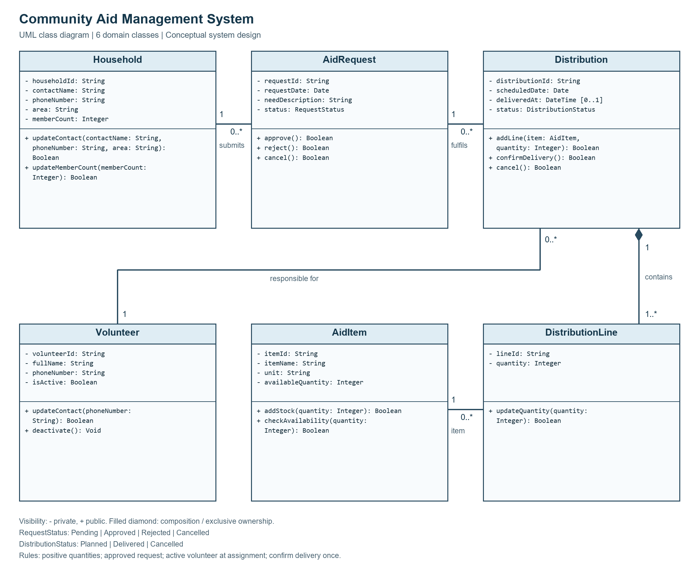
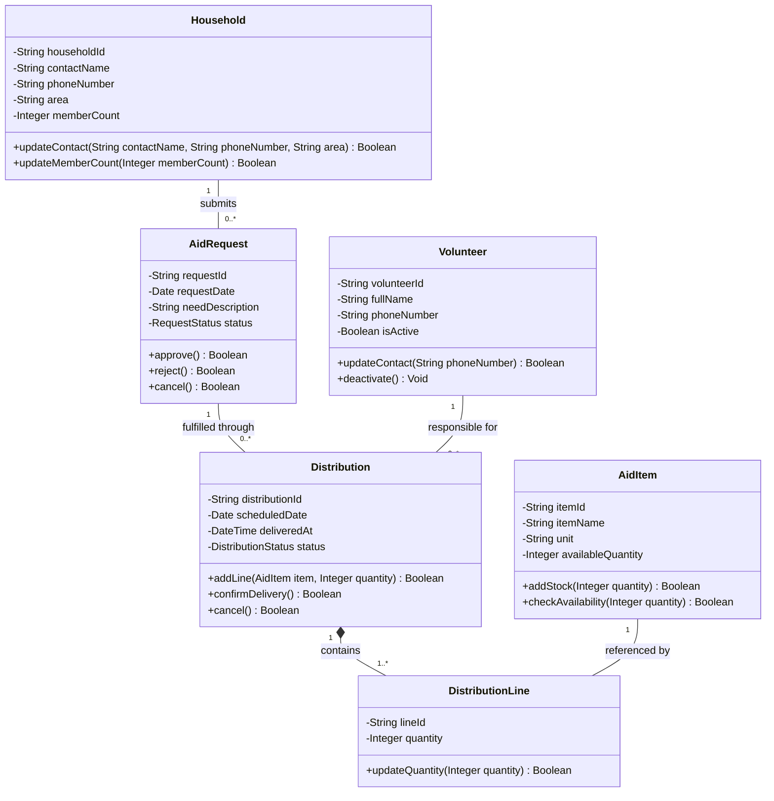

# Report 2: UML Class Diagram

## 1. Model overview

The Community Aid Management System contains six main domain classes. Private attributes use `-`; public operations use `+`. `Boolean` indicates success or failure, and `Void` indicates no return value. Identifiers are unique and stable. Relationships represent object references; foreign key fields are not repeated in this conceptual model.

## 2. Complete class diagram

[Open the editable draw.io file](../diagrams/uml_class_diagram.drawio). The Mermaid version below provides an additional source representation.

`deliveredAt` has attribute multiplicity `[0..1]`: it is absent until delivery. The simplified Mermaid display shows its type; the editable drawing should explicitly label it `- deliveredAt: DateTime [0..1]`.

## 3. Classes, attributes, and methods

### Household

| Attribute | Type | Description |
|---|---|---|
| householdId | String | Unique household record identifier. |
| contactName | String | Household contact person's name. |
| phoneNumber | String | Contact number; text preserves leading zeroes and country prefixes. |
| area | String | Household's residential area. |
| memberCount | Integer | Number of members; must be positive. |

- `+ updateContact(contactName: String, phoneNumber: String, area: String): Boolean` updates valid contact details.
- `+ updateMemberCount(memberCount: Integer): Boolean` accepts a positive count.

### AidRequest

| Attribute | Type | Description |
|---|---|---|
| requestId | String | Unique request identifier. |
| requestDate | Date | Date of submission. |
| needDescription | String | Description of requested assistance. |
| status | RequestStatus | Pending, Approved, Rejected, or Cancelled. |

- `+ approve(): Boolean` changes Pending to Approved following a staff decision.
- `+ reject(): Boolean` changes Pending to Rejected following a staff decision.
- `+ cancel(): Boolean` cancels a Pending or Approved request only when none of its distributions is Planned or Delivered. Planned distributions must first be cancelled; a request with a delivered distribution cannot be cancelled.

### AidItem

| Attribute | Type | Description |
|---|---|---|
| itemId | String | Unique item identifier. |
| itemName | String | Name of the aid item. |
| unit | String | Whole-unit measure, such as basket, bag, or kit. |
| availableQuantity | Integer | Available stock; cannot be negative. |

- `+ addStock(quantity: Integer): Boolean` adds a positive quantity.
- `+ checkAvailability(quantity: Integer): Boolean` returns whether a positive requested quantity is available.

Stock deduction is an effect of `Distribution.confirmDelivery()`. Transaction coordination belongs to implementation design outside this conceptual model.

### Volunteer

| Attribute | Type | Description |
|---|---|---|
| volunteerId | String | Unique volunteer identifier. |
| fullName | String | Volunteer name. |
| phoneNumber | String | Contact number. |
| isActive | Boolean | Whether the volunteer is eligible for new assignments. |

- `+ updateContact(phoneNumber: String): Boolean` updates a valid contact number.
- `+ deactivate(): Void` prevents new assignments while preserving existing assignment history. Existing planned assignments require staff review where necessary.

### Distribution

| Attribute | Type | Description |
|---|---|---|
| distributionId | String | Unique delivery identifier. |
| scheduledDate | Date | Planned delivery date. |
| deliveredAt | DateTime [0..1] | Actual confirmation time; absent before delivery. |
| status | DistributionStatus | Planned, Delivered, or Cancelled. |

- `+ addLine(item: AidItem, quantity: Integer): Boolean` adds an item and positive quantity while Planned. If the item already has a line, its quantity is increased instead of creating a duplicate line.
- `+ confirmDelivery(): Boolean` succeeds only while Planned, with an Approved request and enough stock for every item. It deducts stock, records delivery time, and sets Delivered as one indivisible operation. Repeated confirmation fails without further deductions.
- `+ cancel(): Boolean` changes Planned to Cancelled without stock deductions.

A distribution is created with its request, volunteer, and first line. This creation rule ensures that its `1..*` composition multiplicity always holds; a constructor is not shown in the simplified diagram.

### DistributionLine

| Attribute | Type | Description |
|---|---|---|
| lineId | String | Unique distribution line identifier. |
| quantity | Integer | Positive whole-unit quantity of its associated item. |

- `+ updateQuantity(quantity: Integer): Boolean` changes the quantity only while the owning distribution is Planned and the new quantity is positive.

## 4. Relationships and multiplicities

| Relationship | Type | Explanation |
|---|---|---|
| Household `1` - AidRequest `0..*` | Association | Each request belongs to one household; a household may have no requests or many. |
| AidRequest `1` - Distribution `0..*` | Association | Each distribution belongs to one request; a request may have no distributions or several. The request must be Approved when a distribution is created. |
| Volunteer `1` - Distribution `0..*` | Association | Each distribution has one responsible volunteer; a volunteer may have no assignments or many. The volunteer must be active when assigned. |
| Distribution `1` - DistributionLine `1..*` | Composition | Each distribution owns one or more lines. Each line belongs exclusively to one distribution and cannot exist independently. The filled diamond is placed at Distribution. |
| AidItem `1` - DistributionLine `0..*` | Association | Each line references exactly one item; an item may appear in no lines or many lines. |

No inheritance or aggregation is necessary for this model. Association and composition express the required domain relationships.

## 5. Supporting data types

- `RequestStatus = {Pending, Approved, Rejected, Cancelled}`.
- `DistributionStatus = {Planned, Delivered, Cancelled}`.
- String, Integer, Boolean, Date, and DateTime are data types.

The status enumerations are supporting types rather than additional domain classes.

## 6. Consistency rules

- Review operations represent decisions made by authorised staff, not automatic eligibility decisions.
- All member counts and line quantities are positive; stock is non-negative.
- Planned deliveries do not reserve stock. Delivery confirmation rechecks current availability.
- Delivered and Cancelled distributions and their lines cannot be edited.
- Delivered records and associated household, volunteer, item, and request references are retained.
- The model supports partial delivery through multiple distributions, but does not calculate whether free-text needs have been fully satisfied.
